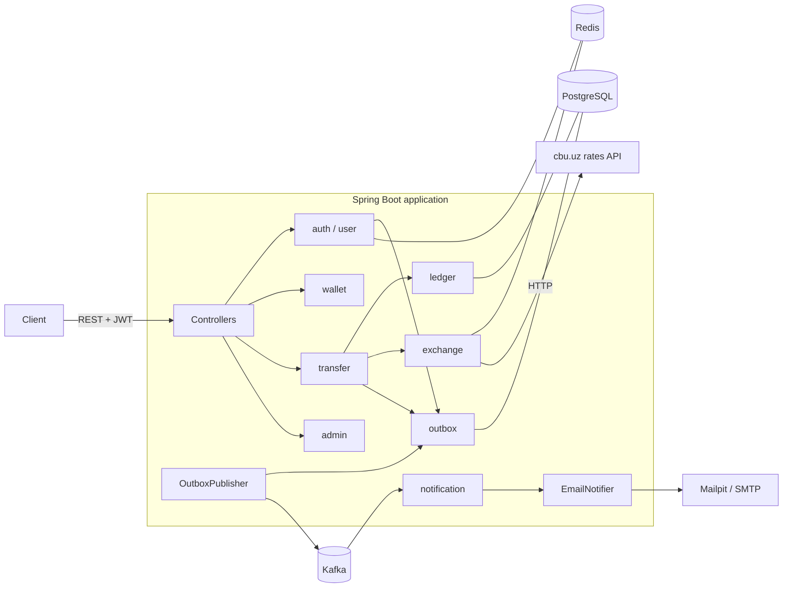
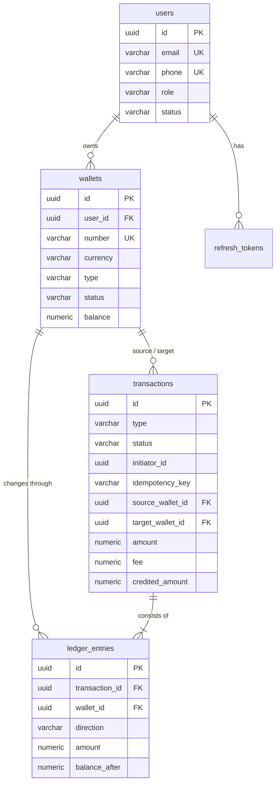

# Digital Wallet

[](https://github.com/FaxriyorBT/digital-wallet/actions/workflows/ci.yml)

REST API for a multi-currency digital wallet. Users open wallets in UZS, USD and EUR, top them up and send money
to each other. Transfers between currencies are converted at the official rate of the Central Bank of Uzbekistan.

The main goal of the project is correct money movement: a double-entry ledger, row-level locking that holds up
under concurrent requests, idempotent payment requests and reliable event publishing with a transactional outbox.

## Features

- Registration, JWT access tokens and refresh tokens with rotation and reuse detection
- Wallets in UZS, USD and EUR with 16-digit numbers protected by a Luhn check digit
- Top-ups (simulated card payment)
- Transfers between users: 0.5% fee (free between your own wallets), currency conversion, per-transfer and daily limits
- `Idempotency-Key` header on every money operation, so a retried request never charges twice
- Transaction history with filters and paging, wallet statement with the balance after every entry
- Declined transfers stay in the sender's history with the reason
- Email notifications through Kafka: welcome email, money sent, money received
- Admin API: user search, blocking users, freezing wallets, all transactions, daily turnover
- Nightly ledger reconciliation

## Tech stack

| Area | Technology |
|---|---|
| Language, framework | Java 25 (virtual threads), Spring Boot 4.1 |
| API | Spring Web MVC, Bean Validation, RFC 9457 problem details, springdoc-openapi (Swagger UI) |
| Data | PostgreSQL 18, Spring Data JPA / Hibernate, Flyway, JPA Specifications |
| Security | Spring Security, OAuth2 Resource Server (HS256 JWT), BCrypt |
| Cache | Redis (exchange rates, failed login counter) |
| Messaging | Apache Kafka (KRaft), transactional outbox, dead letter topics |
| Integration | RestClient, Resilience4j (retry, circuit breaker) against the CBU rates API |
| Notifications | Spring Mail, Mailpit for local testing |
| Tooling | Maven, Lombok, MapStruct, Docker, Docker Compose, GitHub Actions |
| Tests | JUnit 5, Mockito, MockMvc, Testcontainers, Awaitility, JaCoCo |

## Architecture

A modular monolith: one deployable application, split into packages by business feature. Modules talk to each
other through services and events, so a module such as notifications could be moved into its own service later.



| Package | Responsibility |
|---|---|
| `auth` | registration, login, access and refresh tokens, login attempt limiting |
| `user` | profile, password change, administrator bootstrap |
| `wallet` | wallets, wallet numbers, system wallets |
| `transfer` | transfers, top-ups, fee and conversion, limits, idempotency |
| `transaction` | transaction history and search |
| `ledger` | double-entry postings, statements, reconciliation |
| `exchange` | CBU client, rate storage and cache |
| `outbox` | storing events and publishing them to Kafka |
| `notification` | Kafka consumers and emails |
| `admin` | admin endpoints and statistics |
| `common` | configuration, security, error handling, shared types |

## Design decisions

### Double-entry ledger

Balances are never changed directly. Every operation is recorded as ledger entries whose debits and credits cancel
out per currency, and `LedgerService` is the only class that changes a balance. The other side of each movement is a
system wallet:

| Operation | Entries |
|---|---|
| Top-up of 100 UZS | FUNDING UZS debit 100, user wallet credit 100 |
| Transfer of 100 UZS with 0.5 fee | sender debit 100.50, recipient credit 100, FEE UZS credit 0.50 |
| Transfer of 10 USD to a UZS wallet | sender debit 10, EXCHANGE USD credit 10, EXCHANGE UZS debit 120 000, recipient credit 120 000 |

The nightly reconciliation job checks that every stored balance equals the sum of its entries and that each
currency adds up to zero. System wallets keep no balance column: almost every transfer touches the fee wallet, and
updating one shared row would serialize all transfers on it.

### Concurrency

A transfer locks both wallets with `SELECT ... FOR UPDATE` before reading balances, so two parallel transfers from one
wallet cannot both spend the same money. Locks are always taken in the order of wallet ids, which rules out the
deadlock where A to B and B to A each hold one lock. Status changes that rarely race (closing or freezing a wallet)
rely on optimistic locking with `@Version` instead. `ConcurrentTransferIT` sends 40 transfers at once and checks that
the balance never goes negative.

### Idempotency

Money endpoints require an `Idempotency-Key` header. The key is stored with the transaction under a unique
constraint `(initiator_id, idempotency_key)`. A repeated request gets the original result, the same key with a
different body is rejected with `422`, and a parallel duplicate is stopped by the database constraint.

### Transactional outbox

Sending to Kafka inside a database transaction can go wrong both ways: the message is sent but the transaction rolls
back, or the transaction commits and the send fails. Events are therefore written to the `outbox_events` table in
the same transaction as the business change, and `OutboxPublisher` delivers them afterwards. Polling uses
`FOR UPDATE SKIP LOCKED`, so several instances can run it safely. Delivery is at least once and the consumer
ignores duplicates using the `processed_events` table. Messages that keep failing go to a `.DLT` topic.

### Exchange rates

Rates are pulled from the CBU API on startup and every three hours, stored in PostgreSQL and cached in Redis.
The HTTP client has connect and read timeouts, retries with exponential backoff on network and 5xx errors, and a
circuit breaker. If CBU is unavailable the last stored rates stay in use.

### Security

- Access tokens are short-lived (15 minutes) JWTs validated by Spring's OAuth2 Resource Server.
- Refresh tokens are random 256-bit values; only their SHA-256 hash is stored. Every refresh token works once, and
  reusing an old one revokes all sessions of the user.
- Five failed logins lock the email for 15 minutes (counter in Redis).
- Blocking a user or changing the password revokes the user's refresh tokens.
- Someone else's wallet returns `404`, not `403`, so ids cannot be probed.

## Data model



Also: `exchange_rates`, `refresh_tokens`, `outbox_events`, `processed_events`. The schema is managed by Flyway
(`src/main/resources/db/migration`), Hibernate only validates it.

## Running

Requirements: Docker. JDK 25 only if you want to run the application outside Docker.

```bash
cp .env.example .env
docker compose up -d --build
```

| Service | URL |
|---|---|
| API | http://localhost:8080 |
| Swagger UI | http://localhost:8080/swagger-ui.html |
| Mailpit (sent emails) | http://localhost:8025 |
| Health | http://localhost:8080/actuator/health |

The administrator account is created from `ADMIN_EMAIL` and `ADMIN_PASSWORD` in `.env`.

To run the application from an IDE, start only the infrastructure and run the app with the `.env` file in the
project root:

```bash
docker compose up -d postgres redis kafka mailpit
./mvnw spring-boot:run
```

PostgreSQL is exposed on port `5433` to avoid a clash with a locally installed instance.

## Quick walkthrough

```bash
# register and log in
curl -s -X POST localhost:8080/api/v1/auth/register -H 'Content-Type: application/json' \
  -d '{"email":"aziz@example.com","phone":"+998901234567","password":"Secret123","fullName":"Aziz Karimov"}'
TOKEN=$(curl -s -X POST localhost:8080/api/v1/auth/login -H 'Content-Type: application/json' \
  -d '{"email":"aziz@example.com","password":"Secret123"}' | sed 's/.*"accessToken":"\([^"]*\)".*/\1/')

# open a wallet and top it up
curl -s -X POST localhost:8080/api/v1/wallets -H "Authorization: Bearer $TOKEN" \
  -H 'Content-Type: application/json' -d '{"currency":"UZS"}'
curl -s -X POST localhost:8080/api/v1/wallets/{walletId}/top-ups -H "Authorization: Bearer $TOKEN" \
  -H 'Content-Type: application/json' -H "Idempotency-Key: $(uuidgen)" -d '{"amount":500000}'

# send money
curl -s -X POST localhost:8080/api/v1/transfers -H "Authorization: Bearer $TOKEN" \
  -H 'Content-Type: application/json' -H "Idempotency-Key: $(uuidgen)" \
  -d '{"sourceWalletId":"{walletId}","targetWalletNumber":"{16-digit number}","amount":100000}'
```

Swagger UI is the easier way to try everything: log in, copy the access token and use the Authorize button.

## API

| Method | Path | Description |
|---|---|---|
| POST | `/api/v1/auth/register` | Create an account |
| POST | `/api/v1/auth/login` | Get access and refresh tokens |
| POST | `/api/v1/auth/refresh` | Rotate the refresh token |
| POST | `/api/v1/auth/logout` | Revoke a refresh token |
| GET, PATCH | `/api/v1/users/me` | Read or update the profile |
| PUT | `/api/v1/users/me/password` | Change password |
| POST, GET | `/api/v1/wallets` | Open a wallet, list own wallets |
| GET | `/api/v1/wallets/{id}` | Wallet with balance |
| POST | `/api/v1/wallets/{id}/close` | Close an empty wallet |
| POST | `/api/v1/wallets/{id}/top-ups` | Top up (requires `Idempotency-Key`) |
| GET | `/api/v1/wallets/{id}/statement` | Ledger entries with running balance |
| GET | `/api/v1/wallets/lookup?number=` | Recipient check before a transfer |
| POST | `/api/v1/transfers/quote` | Fee and converted amount, nothing is moved |
| POST | `/api/v1/transfers` | Transfer (requires `Idempotency-Key`) |
| GET | `/api/v1/transactions` | History with filters and paging |
| GET | `/api/v1/transactions/{id}` | One transaction |
| GET | `/api/v1/exchange-rates` | Latest CBU rates (public) |
| GET | `/api/v1/admin/users` | Search users |
| GET | `/api/v1/admin/users/{id}/wallets` | Wallets of a user |
| PATCH | `/api/v1/admin/users/{id}/status` | Block or unblock a user |
| PATCH | `/api/v1/admin/wallets/{id}/status` | Freeze or unfreeze a wallet |
| GET | `/api/v1/admin/transactions` | Search all transactions |
| GET | `/api/v1/admin/stats/daily` | Daily turnover and fees |

Errors follow RFC 9457 and carry a machine-readable `code`:

```json
{
  "type": "about:blank",
  "title": "Unprocessable Content",
  "status": 422,
  "detail": "Insufficient funds",
  "instance": "/api/v1/transfers",
  "code": "INSUFFICIENT_FUNDS"
}
```

## Tests

```bash
./mvnw verify
```

Unit tests run with Surefire, integration tests (`*IT`) with Failsafe against PostgreSQL, Kafka and Redis started
by Testcontainers, so Docker has to be running. Worth a look:

- `ConcurrentTransferIT` - 40 simultaneous transfers from one wallet, and opposite transfers that would deadlock without ordered locking
- `TransferIT` - fees, conversion, limits, idempotent retries, declined transfers, statements
- `NotificationIT` - outbox to Kafka to email, and a duplicate message handled only once
- `AuthIT` - refresh token rotation and reuse detection, login lockout
- `WalletControllerTest` - web layer slice: security, validation and error format

The coverage report is written to `target/site/jacoco/index.html`.

## Possible improvements

- Replace outbox polling with change data capture (Debezium) for lower latency.
- Access tokens stay valid until they expire (up to 15 minutes after blocking); a Redis denylist would close that gap.
- The reconciliation and cleanup jobs would need ShedLock when running several instances (the outbox publisher is already safe).
- Rate limiting on the wallet lookup endpoint to make enumeration of wallet numbers slower.
- Distributed tracing with OpenTelemetry and Prometheus metrics.
- Top-ups are simulated; a real payment provider would make them asynchronous with a webhook callback.
